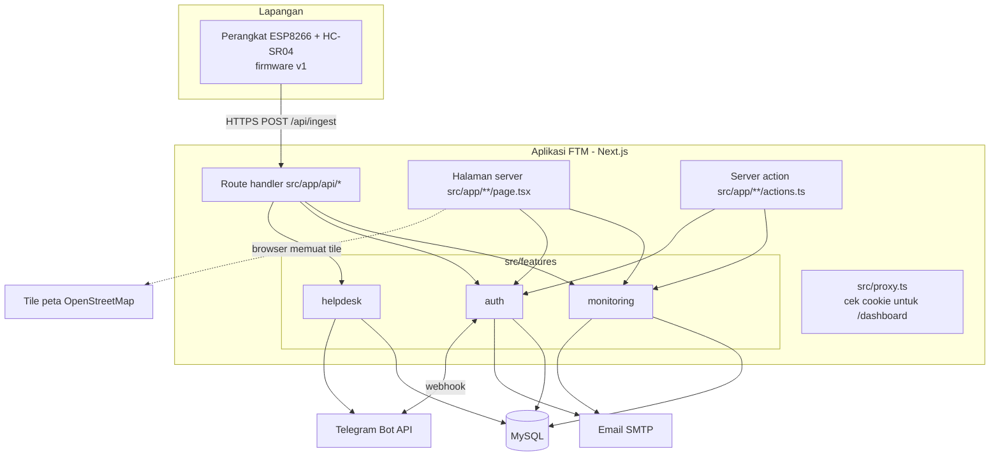
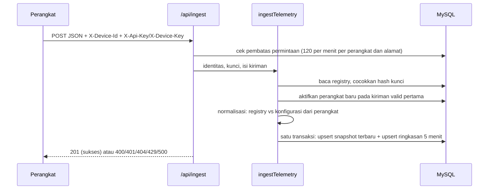

# Arsitektur Sistem

Status: **terkini**, diperiksa terhadap kode pada 25 Oktober 2026.
Arah jangka panjang dicatat di [catatan keputusan](decisions/README.md). Versi tanpa
istilah pemrograman: [cara kerja FTM](cara-kerja-ftm.md).

## Ringkasan

FTM adalah **satu aplikasi Next.js** (kerangka kerja web yang memuat halaman dan
API sekaligus) yang ditulis dalam TypeScript dan menyimpan data di MySQL. Aplikasi
ini menerima data dari perangkat ESP8266 di lapangan, menyimpannya, lalu
menampilkannya di dashboard.



Penjelasan diagram:

- **Route handler** (`src/app/api/**/route.ts`) adalah pintu API: menerima data
  perangkat, login, data dashboard, ekspor CSV, unduhan paket firmware, helpdesk,
  pemeriksaan kesehatan, dan webhook Telegram.
- **Halaman server** dirender di server dan membaca data lewat modul.
- **Server action** (fungsi server yang dipanggil langsung dari formulir) dipakai
  untuk aksi admin dan pengajuan perangkat.
- **Modul** di `src/features/` memuat logika dan akses database.
- Aplikasi tidak punya proses latar belakang: tidak ada tugas terjadwal, backup
  otomatis, atau alarm.

## Modul

| Modul                     | Isi utama                                                                                                                                                                                                                                                                       |
| ------------------------- | ------------------------------------------------------------------------------------------------------------------------------------------------------------------------------------------------------------------------------------------------------------------------------- |
| `src/features/monitoring` | Perhitungan domain (volume, status, sisa jam genset, kapasitas, konsumsi), normalisasi kiriman perangkat, registry lokasi/tangki/perangkat, penyimpanan pembacaan, penerimaan data perangkat, pemeriksaan kesiapan, ekspor CSV, komponen dashboard, peta, grafik, dan visual 3D |
| `src/features/auth`       | Akun, sesi, peran, OTP admin, CSRF (pengaman agar aksi tidak bisa dipicu dari situs lain), captcha, email, pembatas jumlah permintaan, audit, dan Telegram (binding, perintah, notifikasi admin)                                                                                |
| `src/features/helpdesk`   | Widget bantuan di web dan relay pesan ke topik Telegram                                                                                                                                                                                                                         |
| `src/components`          | Kerangka halaman bersama (header, footer, menu, halaman akun) dan logo                                                                                                                                                                                                          |
| `src/lib`                 | Utilitas umum (pesan error yang aman ditampilkan), katalog pengaturan `src/lib/config/`, dan koneksi database bersama `src/lib/database/`                                                                                                                                       |

Di dalam modul, setiap jenis berkas punya foldernya sendiri:

- **logika murni** (tanpa database) dan **view model** di `domain/`, misalnya
  `tank-volume.ts`, `status.ts`, `normalize-reading.ts`, `dashboard-view-model.ts`;
- **layanan** (alur kerja yang menggabungkan beberapa langkah) di `server/`, misalnya
  `monitoring/server/ingest-telemetry.ts` dan `auth/server/auth-service.ts`;
- **repositori** (kueri SQL) di `server/repositories/`, bernama `mysql-*-repository.ts`;
- **komponen** tampilan di `components/`.

Modul yang sudah memakai bentuk folder ADR 0011:

```text
src/features/helpdesk/
├── components/helpdesk-widget.tsx         tombol dan jendela bantuan
├── server/
│   ├── helpdesk-service.ts                pintu untuk src/app
│   ├── helpdesk-notifications.ts          kabar pesan baru ke admin
│   ├── helpdesk-telegram.ts               relay balasan dari Telegram
│   └── repositories/mysql-helpdesk-repository.ts   kueri SQL
└── types/helpdesk.ts

src/features/auth/
├── components/          tombol keluar, widget captcha
├── domain/              validasi isian akun, aturan alamat tujuan setelah login
├── server/              layanan akun, sesi, guard, CSRF, kripto, pengaturan auth,
│                        email, captcha, Telegram, pembatas permintaan;
│                        auth-service.ts (pintu kompatibilitas) dan auth-flows/: login,
│                        pendaftaran, kata sandi, verifikasi email, sesi, Telegram
│   └── repositories/    mysql-auth-repository.ts (pintu kompatibilitas) dan accounts/:
│                        pengguna, sesi, administrasi pengguna, pengajuan akses, token
│                        (OTP, atur ulang sandi, verifikasi email), Telegram, audit
├── tests/
└── types/auth.ts

src/features/monitoring/
├── components/          dashboard, peta, grafik, jam, kontrol muat ulang, visual 3D,
│                        jeda muat ulang dashboard (refresh-interval.ts)
├── data/                data contoh untuk mode penyimpanan memori (konstanta murni)
├── domain/              rumus volume, status, sisa jam genset, normalisasi kiriman,
│                        ringkasan 5 menit, view model dashboard dan detail tangki, ekspor CSV
├── server/              penyimpanan, registry, penerimaan data perangkat, pemeriksaan kesiapan
│   └── repositories/    kueri SQL pembacaan dan registry
├── tests/
└── types/monitoring.ts
```

Koneksi database bersama ada di `src/lib/database/mysql-connection.ts` karena dipakai
semua modul; hanya repositori yang boleh memakainya (dicek ESLint).

```text
src/features/devices/
├── domain/device-request.ts   validasi pengajuan, kapasitas tangki, konsumsi, label status
├── server/                    layanan pengajuan, pembuatan perangkat dari kiriman pertama,
│                              kunci perangkat, paket firmware, email paket, notifikasi admin
│   └── repositories/          mysql-device-request-repository.ts (pintu kompatibilitas)
│                              dan device-requests/ (SQL menurut tanggung jawab)
└── tests/                     termasuk snapshot paket firmware v1 dan tes MySQL pemasangan
```

Modul `devices` memakai tipe data dan rumus dari `monitoring` (tangki, lokasi, angka).
`monitoring/server/ingest-telemetry.ts` mengaktifkan perangkat pada kiriman pertama lewat
layanan `devices`, bukan langsung ke repositorinya. Impor antar-modul selalu memakai alias
`@/features/<modul>/...`; impor di dalam modul memakai jalur relatif.

```text
src/features/admin/
├── server/maintenance-service.ts      reset pembacaan, pembersihan data uji, reset data perangkat
│   └── repositories/mysql-maintenance-repository.ts   kueri SQL perawatan data
└── tests/                            termasuk tes MySQL cakupan reset pembacaan
```

Semua modul kini memakai bentuk folder ADR 0011; folder `lib/` lama tidak ada lagi.

## Lapisan dan arah ketergantungan

Arah yang dituju (ADR [0002](decisions/0002-satu-repositori-modular-monolith.md),
rinciannya di ADR [0011](decisions/0011-struktur-modul-dan-aturan-lapisan.md): daftar
modul `monitoring`, `devices`, `auth`, `helpdesk`, `admin`; bentuk folder
`components/`, `domain/`, `server/`, `server/repositories/`, `types/`):

```text
src/app (halaman, route handler, server action — tipis)
    → layanan modul
        → repositori (SQL)
            → koneksi database
```

Logika murni tidak boleh mengakses database dan hanya ada di satu tempat.

Pengajuan perangkat memakai pintu layanan
`src/features/devices/server/device-request-service.ts`. Dua halaman pengajuan,
aksi formulir pengguna dan admin, serta route unduhan paket memanggil layanan ini.
Selama transisi, layanan meneruskan fungsi repositori yang sama melalui pintu
kompatibilitas `server/repositories/mysql-device-request-repository.ts`. Implementasi SQL
berada di `server/repositories/device-requests/`, dipisahkan menurut tanggung jawab:

| Berkas                                                                     | Tanggung jawab                                                                                           |
| -------------------------------------------------------------------------- | -------------------------------------------------------------------------------------------------------- |
| `requests.ts`                                                              | Daftar, pembuatan, dan pembacaan pengajuan dengan penguncian baris                                       |
| `review.ts`                                                                | Persetujuan, penolakan, dan pencabutan akses perangkat                                                   |
| `packages.ts`                                                              | Pencatatan email, pembaruan token, pembuatan ulang, dan unduhan paket                                    |
| `activation.ts`                                                            | Pemeriksaan kunci dan aktivasi pada kiriman valid pertama                                                |
| `catalog.ts`, `registry.ts`, `package-queries.ts`, `package-generation.ts` | Katalog hardware/template, registry nonaktif, kueri paket, dan pembuatan paket dalam transaksi pemanggil |
| `types.ts`, `row-mappers.ts`, `events.ts`, `shared.ts`                     | Tipe baris/hasil, pemetaan baris, pencatatan peristiwa, dan serialisasi                                  |

`index.ts` dan pintu lama mengekspor fungsi serta tipe publik yang sama secara
eksplisit. Setiap alur tetap memakai koneksi transaksi yang sama; SQL, urutan
operasi, penguncian baris, commit, rollback, dan pelepasan koneksi tidak berubah.
Seluruh berkas repositori ditandai `server-only`. Pemeriksaan akun,
CSRF, pengiriman email, dan pembaruan halaman masih berada di pemanggilnya dengan
urutan yang sama. Pemisahan modul `devices` dan pemindahan alur tersebut dilakukan
bertahap sesuai ADR 0011.

Pintu layanan lain dengan pola yang sama:

- `src/features/auth/server/`: audit keamanan akun, profil, dan manajemen pengguna;
- `src/features/helpdesk/server/helpdesk-service.ts`: route bantuan web;
- `src/features/admin/server/maintenance-service.ts`: aksi perawatan data
  (reset pembacaan, pembersihan data uji).

Sejak Oktober 2026 tidak ada lagi berkas di `src/app` yang mengimpor repositori,
koneksi database, atau `mysql2`. Aturan ini dicek ESLint (`no-restricted-imports`
di `eslint.config.mjs`), sehingga `pnpm lint` dan CI gagal bila dilanggar.
ESLint juga menolak layanan di `server/` yang memakai repositori atau koneksi database
milik modul lain (aturan 2 ADR 0011). Repositori modul sendiri diimpor dengan jalur
relatif pendek, misalnya `./repositories/...` atau `../lib/...`. Berkas di `domain/`
tidak boleh memakai database, `server/`, email, berkas, data permintaan, atau
pengaturan; aturan ini juga dicek ESLint.

Modul khusus server (repositori, koneksi database, layanan di `server/`, email,
Telegram, sesi, CSRF, kunci perangkat, paket firmware, dan konfigurasi rahasia)
diawali `import "server-only";`, sesuai panduan keamanan data Next.js. Bila salah
satunya terimpor ke komponen browser, `pnpm build` gagal dan menunjuk berkas
penyebabnya. Di tes Vitest penanda ini diganti modul kosong.

Route handler membalas lewat `src/lib/http/json-response.ts`: `jsonOk` (`{ ok: true, data }`),
`jsonError` (`{ ok: false, error }`), `jsonTooManyRequests` (429 dengan `Retry-After`),
dan `jsonCaughtError` (pesan aman untuk error yang ditangkap). Hanya `/api/ready`,
`/api/dashboard/overview`, dan unduhan paket firmware yang bentuk balasannya berbeda.

Kit UI bersama ada di `src/components/ui/`:

| Berkas            | Isi                                                                                     |
| ----------------- | --------------------------------------------------------------------------------------- |
| `card.tsx`        | `Card`: kartu putih standar (`as` untuk `section`/`article`/`div`)                      |
| `status-pill.tsx` | `StatusPill`: lencana status berbentuk pil dengan titik warna                           |
| `message.tsx`     | `FormErrorMessage` (kotak error formulir), `ActionMessage` (hasil aksi di dialog)       |
| `button-class.ts` | `PRIMARY_BLOCK_BUTTON_CLASS`, `SECONDARY_BUTTON_CLASS` untuk `<button>` maupun `<Link>` |
| `status-tone.ts`  | peta warna status                                                                       |

Tes `ui-kit.test.tsx` memastikan setiap komponen menghasilkan HTML yang sama persis
dengan markup lama.

Warna status (lencana dan titik penanda) diambil dari satu peta,
`src/components/ui/status-tone.ts`: `success` hijau, `warning` kuning, `danger` merah,
`neutral` abu-abu, `info` biru. Warna isi grafik dan hiasan tidak termasuk peta ini.

Angka dan tanggal untuk teks yang dilihat pengguna ditulis lewat `src/lib/format.ts`
(`formatNumber`, `formatDateTimeJakarta`), dipakai halaman, komponen, email, dan pesan
Telegram.

Semua pengaturan dibaca dari dua katalog di `src/lib/config/`:

- `server-env.ts`: pengaturan dan rahasia yang hanya boleh dibaca server (database,
  email, kunci, Telegram, aturan akun), dikelompokkan dan diberi penjelasan singkat;
- `public-env.ts`: tiga nilai `NEXT_PUBLIC_*` yang memang ikut terkirim ke browser.

Nilai dibaca saat dipakai, sama seperti membaca `process.env` langsung. ESLint
(`no-restricted-properties`) menolak `process.env` di luar katalog ini, kecuali di tes.

Penyimpangan yang **masih ada** per 25 Oktober 2026 dan akan dirapikan bertahap
tanpa mengubah perilaku:

- ambang status sisa jam genset ditulis di tiga tempat dengan kelas yang berbeda
  (`status.ts` dan dua halaman detail tangki);
- pola tampilan yang sama (kartu, format angka, warna status) ditulis ulang di
  banyak file;
- dua halaman detail tangki (`/dashboard/tanks/[id]` dan `/dashboard/ringkas/tanks/[id]`) hanya
  berbagi 3 fungsi yang identik; tabel ambang sisa jam, lencana, dan panelnya sengaja bergaya
  berbeda. Menyatukannya mengubah tampilan dan menunggu keputusan pemilik. Halaman besar
  (`/dashboard/tanks/[id]`, `/dashboard/admin/users`) dan repositori besar sudah dipecah;
- `auth/server/rate-limit.ts`, `auth/server/admin-telegram-notifications.ts`, dan
  `devices/server/device-provisioning.ts` masih menjalankan kueri SQL sendiri, bukan lewat
  repositori. Ketiganya dikecualikan dari
  aturan ESLint layanan secara tertulis di `eslint.config.mjs` sampai SQL-nya dipindah;
- `monitoring/server/deployment-probes.ts` (pemeriksaan kesiapan `/api/ready`) menguji
  koneksi database secara langsung; dikecualikan secara tertulis dari aturan layanan;
- halaman depan memuat kode STO pilot (TPH, NJA, JTO), dan formulir pengajuan perangkat
  memakai contoh isian "STO Bangil", "Pasuruan", serta koordinat sekitar Pasuruan. Keduanya teks
  yang dilihat pengguna; menggantinya dengan contoh fiktif adalah perubahan tampilan (FTM-028);
- formulir admin "Bersihkan semua data perangkat" dan "Bersihkan pengajuan terpilih"
  dicabut dari halaman pada Juli 2026, tetapi server action `resetMonitoringDeviceDataAction`,
  layanan, dan kueri SQL di belakangnya masih ada tanpa pemakai. Komponen formulirnya sudah
  dihapus; menghapus atau menampilkan kembali kemampuan itu menunggu keputusan pemilik;
- jumlah liter ditulis dengan dua cara: `/dashboard/detail` (termasuk petanya) dan teks
  halaman `/dashboard/tanks/[id]` menampilkan sampai 3 angka desimal, sedangkan dashboard
  utama, halaman `/dashboard/ringkas/tanks/[id]`, dan grafik volume di kedua halaman tangki
  membulatkan ke bilangan bulat. Keduanya sudah memakai `formatNumber` dengan jumlah
  desimal tertulis jelas; penyeragamannya adalah perubahan tampilan dan menunggu
  keputusan pemilik.

## Alur penerimaan data perangkat



- **Snapshot terbaru** (`monitoring_latest_readings`): satu baris per perangkat,
  selalu ditimpa kiriman terbaru. Sumber tampilan langsung.
- **Ringkasan 5 menit** (`monitoring_readings`): satu baris per perangkat per
  5 menit dengan rata-rata berjalan, minimum, maksimum, dan jumlah sampel. Waktu
  bucket memakai **waktu terima server**. Sumber grafik dan ekspor.
- Konfigurasi tangki yang dikirim perangkat dibandingkan dengan registry. Bila
  berbeda jauh, nilai perangkat diabaikan dan server menghitung ulang dengan
  registry.

Format kiriman ini adalah **kontrak perangkat v1** dan dibekukan (lihat
[kontrak API](api-contract.md) dan
[ADR 0006](decisions/0006-kontrak-perangkat-berversi.md)).

## Alur pemasangan perangkat baru

1. Petugas mengisi formulir pengajuan (lokasi, dimensi tangki, beban genset).
2. Server menghitung kapasitas dan perkiraan konsumsi, lalu menyimpan pengajuan.
3. Admin menyetujui. Dalam satu transaksi dengan penguncian baris, server membuat
   lokasi, tangki, dan perangkat (belum aktif), kunci perangkat, serta paket
   firmware ZIP yang disimpan terenkripsi.
4. Tautan unduh bertoken (dengan masa berlaku dan batas jumlah unduhan) dikirim
   ke email pengaju.
5. Petugas mengisi Wi-Fi, meng-_compile_, dan mengunggah firmware ke perangkat.
6. Kiriman valid pertama dengan kunci yang cocok mengaktifkan lokasi, tangki, dan
   perangkat.

## Akses dan peran

- Halaman `/dashboard/*` membutuhkan sesi login. `src/proxy.ts` mengarahkan
  pengunjung tanpa cookie sesi ke `/login`.
- Peran `admin` membuka analisis teknis, detail teknis tangki, tinjauan pengajuan,
  manajemen pengguna, dan audit. Peran `user` membuka dashboard, detail ringkas
  tangki, pengajuan perangkat, profil, dan keamanan akun.
- Semua akun aktif melihat semua lokasi. Belum ada pembatasan per lokasi
  ([ADR 0009](decisions/0009-akses-per-lokasi.md)).

## Penyimpanan memori untuk pengembangan

Dengan `SOLAR_TANK_STORAGE_DRIVER="memory"`, registry dan pembacaan disimpan di
memori proses beserta data contoh. Mode ini hanya untuk mencoba halaman publik dan
API penerimaan data. Login dan dashboard membutuhkan MySQL.

## Alat operasional di luar aplikasi

Skrip di `scripts/` (registry pilot, smoke test, backup, pembuat admin) dijalankan
dari terminal dan menulis ke database atau alamat yang sedang diatur. Cara
pakainya ada di [kesiapan pilot](pilot-readiness.md) dan
[pencadangan database](database-backup.md). Versi dokumen arsitektur sebelum
25 Oktober 2026 tetap tersedia di riwayat Git.

## Prinsip desain

- Perangkat dan dashboard hanya berhubungan lewat API.
- Rumus operasional berada di modul domain, bukan di komponen tampilan.
- Client component (bagian tampilan yang berjalan di browser) dibuat kecil, hanya
  untuk interaksi seperti refresh otomatis, jam, peta, dan formulir.
- Tidak ada kredensial atau data operasional di repositori.
- Klaim kesiapan produksi hanya dibuat setelah dibuktikan.
