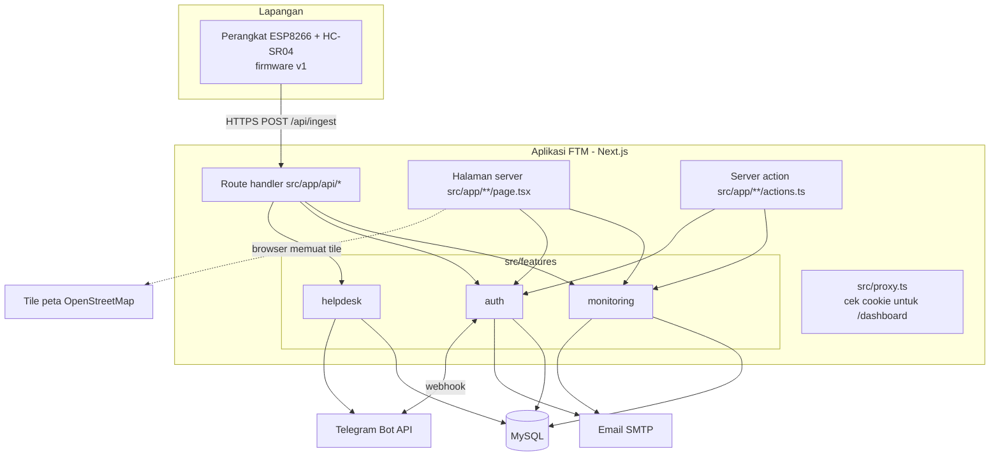
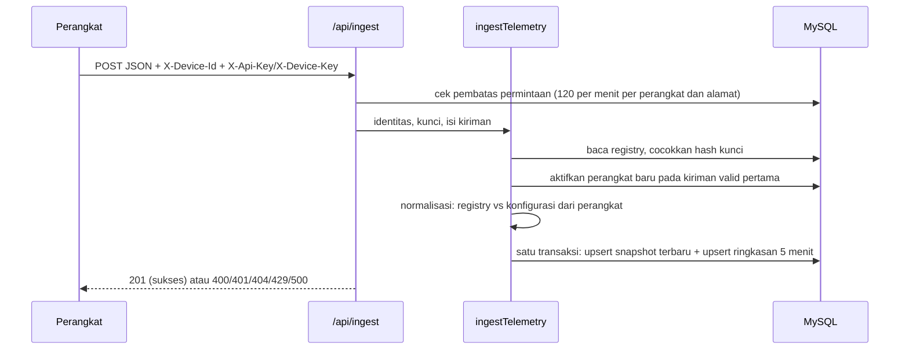

# Arsitektur Sistem

Status: **terkini**, diperiksa terhadap kode pada 25 Oktober 2026.
Arah jangka panjang dicatat di [catatan keputusan](decisions/README.md).

## Ringkasan

FTM adalah **satu aplikasi Next.js** (kerangka kerja web yang memuat halaman dan
API sekaligus) yang ditulis dalam TypeScript dan menyimpan data di MySQL. Aplikasi
ini menerima data dari perangkat ESP8266 di lapangan, menyimpannya, lalu
menampilkannya di dashboard.



Penjelasan diagram:

- **Route handler** (`src/app/api/**/route.ts`) adalah pintu API: menerima data
  perangkat, login, data dashboard, ekspor CSV, unduhan paket firmware, helpdesk,
  pemeriksaan kesehatan, dan webhook Telegram.
- **Halaman server** dirender di server dan membaca data lewat modul.
- **Server action** (fungsi server yang dipanggil langsung dari formulir) dipakai
  untuk aksi admin dan pengajuan perangkat.
- **Modul** di `src/features/` memuat logika dan akses database.
- Aplikasi tidak punya proses latar belakang: tidak ada tugas terjadwal, backup
  otomatis, atau alarm.

## Modul

| Modul                     | Isi utama                                                                                                                                                                                                                                                                                                 |
| ------------------------- | --------------------------------------------------------------------------------------------------------------------------------------------------------------------------------------------------------------------------------------------------------------------------------------------------------- |
| `src/features/monitoring` | Perhitungan domain (volume, status, sisa jam genset, kapasitas, konsumsi), normalisasi kiriman perangkat, registry lokasi/tangki/perangkat, penyimpanan pembacaan, pengajuan perangkat, paket firmware, perawatan data, pemeriksaan kesiapan, ekspor CSV, komponen dashboard, peta, grafik, dan visual 3D |
| `src/features/auth`       | Akun, sesi, peran, OTP admin, CSRF (pengaman agar aksi tidak bisa dipicu dari situs lain), captcha, email, pembatas jumlah permintaan, audit, dan Telegram (binding, perintah, notifikasi admin)                                                                                                          |
| `src/features/helpdesk`   | Widget bantuan di web dan relay pesan ke topik Telegram                                                                                                                                                                                                                                                   |
| `src/components`          | Kerangka halaman bersama (header, footer, menu, halaman akun) dan logo                                                                                                                                                                                                                                    |
| `src/lib`                 | Utilitas umum, misalnya pesan error yang aman ditampilkan                                                                                                                                                                                                                                                 |

Di dalam modul, pola file yang dipakai sekarang:

- **logika murni** (tanpa database): misalnya `tank-volume.ts`, `status.ts`,
  `runtime.ts`, `device-request.ts`, `normalize-reading.ts`, `reading-rollup.ts`;
- **view model** (menyiapkan data untuk tampilan): `dashboard-view-model.ts`,
  `simple-dashboard-model.ts`, `simple-tank-detail-model.ts`,
  `tank-detail-view-model.ts`;
- **repositori** (kueri SQL): `mysql-*-repository.ts`, `helpdesk-repository.ts`;
- **layanan** (alur kerja yang menggabungkan beberapa langkah):
  `ingest-telemetry.ts`, `device-provisioning.ts`, `auth-service.ts`;
- **komponen** tampilan di folder `components/`.

## Lapisan dan arah ketergantungan

Arah yang dituju (ADR [0002](decisions/0002-satu-repositori-modular-monolith.md),
rinciannya di ADR [0011](decisions/0011-struktur-modul-dan-aturan-lapisan.md): daftar
modul `monitoring`, `devices`, `auth`, `helpdesk`, `admin`; bentuk folder
`components/`, `domain/`, `server/`, `server/repositories/`, `types/`):

```text
src/app (halaman, route handler, server action — tipis)
    → layanan modul
        → repositori (SQL)
            → koneksi database
```

Logika murni tidak boleh mengakses database dan hanya ada di satu tempat.

Pengajuan perangkat memakai pintu layanan
`src/features/monitoring/server/device-request-service.ts`. Dua halaman pengajuan,
aksi formulir pengguna dan admin, serta route unduhan paket memanggil layanan ini.
Selama transisi, layanan meneruskan fungsi repositori yang sama; kueri SQL dan
transaksi tetap di `lib/mysql-device-request-repository.ts`. Pemeriksaan akun,
CSRF, pengiriman email, dan pembaruan halaman masih berada di pemanggilnya dengan
urutan yang sama. Pemisahan modul `devices` dan pemindahan alur tersebut dilakukan
bertahap sesuai ADR 0011.

Pintu layanan lain dengan pola yang sama:

- `src/features/auth/server/`: audit keamanan akun, profil, dan manajemen pengguna;
- `src/features/helpdesk/server/helpdesk-service.ts`: route bantuan web;
- `src/features/monitoring/server/maintenance-service.ts`: aksi perawatan data
  (reset pembacaan, pembersihan data uji).

Sejak Oktober 2026 tidak ada lagi berkas di `src/app` yang mengimpor repositori,
koneksi database, atau `mysql2`. Aturan ini dicek ESLint (`no-restricted-imports`
di `eslint.config.mjs`), sehingga `pnpm lint` dan CI gagal bila dilanggar.

Penyimpangan yang **masih ada** per 25 Oktober 2026 dan akan dirapikan bertahap
tanpa mengubah perilaku:

- ambang status sisa jam genset ditulis di tiga tempat dengan kelas yang berbeda
  (`status.ts` dan dua halaman detail tangki);
- pola tampilan yang sama (kartu, format angka, warna status) ditulis ulang di
  banyak file;
- beberapa file sangat besar, misalnya `mysql-device-request-repository.ts`
  (±2.400 baris) dan `mysql-auth-repository.ts` (±1.700 baris).

## Alur penerimaan data perangkat



- **Snapshot terbaru** (`monitoring_latest_readings`): satu baris per perangkat,
  selalu ditimpa kiriman terbaru. Sumber tampilan langsung.
- **Ringkasan 5 menit** (`monitoring_readings`): satu baris per perangkat per
  5 menit dengan rata-rata berjalan, minimum, maksimum, dan jumlah sampel. Waktu
  bucket memakai **waktu terima server**. Sumber grafik dan ekspor.
- Konfigurasi tangki yang dikirim perangkat dibandingkan dengan registry. Bila
  berbeda jauh, nilai perangkat diabaikan dan server menghitung ulang dengan
  registry.

Format kiriman ini adalah **kontrak perangkat v1** dan dibekukan (lihat
[kontrak API](api-contract.md) dan
[ADR 0006](decisions/0006-kontrak-perangkat-berversi.md)).

## Alur pemasangan perangkat baru

1. Petugas mengisi formulir pengajuan (lokasi, dimensi tangki, beban genset).
2. Server menghitung kapasitas dan perkiraan konsumsi, lalu menyimpan pengajuan.
3. Admin menyetujui. Dalam satu transaksi dengan penguncian baris, server membuat
   lokasi, tangki, dan perangkat (belum aktif), kunci perangkat, serta paket
   firmware ZIP yang disimpan terenkripsi.
4. Tautan unduh bertoken (dengan masa berlaku dan batas jumlah unduhan) dikirim
   ke email pengaju.
5. Petugas mengisi Wi-Fi, meng-_compile_, dan mengunggah firmware ke perangkat.
6. Kiriman valid pertama dengan kunci yang cocok mengaktifkan lokasi, tangki, dan
   perangkat.

## Akses dan peran

- Halaman `/dashboard/*` membutuhkan sesi login. `src/proxy.ts` mengarahkan
  pengunjung tanpa cookie sesi ke `/login`.
- Peran `admin` membuka analisis teknis, detail teknis tangki, tinjauan pengajuan,
  manajemen pengguna, dan audit. Peran `user` membuka dashboard, detail ringkas
  tangki, pengajuan perangkat, profil, dan keamanan akun.
- Semua akun aktif melihat semua lokasi. Belum ada pembatasan per lokasi
  ([ADR 0009](decisions/0009-akses-per-lokasi.md)).

## Penyimpanan memori untuk pengembangan

Dengan `SOLAR_TANK_STORAGE_DRIVER="memory"`, registry dan pembacaan disimpan di
memori proses beserta data contoh. Mode ini hanya untuk mencoba halaman publik dan
API penerimaan data. Login dan dashboard membutuhkan MySQL.

## Alat operasional di luar aplikasi

Skrip di `scripts/` (registry pilot, smoke test, backup, pembuat admin) dijalankan
dari terminal dan menulis ke database atau alamat yang sedang diatur. Cara
pakainya ada di [kesiapan pilot](pilot-readiness.md) dan
[pencadangan database](database-backup.md). Versi dokumen arsitektur sebelum
25 Oktober 2026 tetap tersedia di riwayat Git.

## Prinsip desain

- Perangkat dan dashboard hanya berhubungan lewat API.
- Rumus operasional berada di modul domain, bukan di komponen tampilan.
- Client component (bagian tampilan yang berjalan di browser) dibuat kecil, hanya
  untuk interaksi seperti refresh otomatis, jam, peta, dan formulir.
- Tidak ada kredensial atau data operasional di repositori.
- Klaim kesiapan produksi hanya dibuat setelah dibuktikan.
