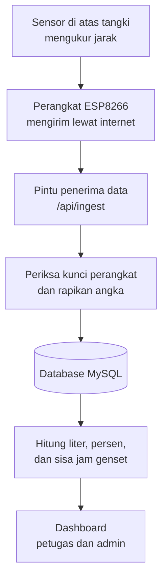
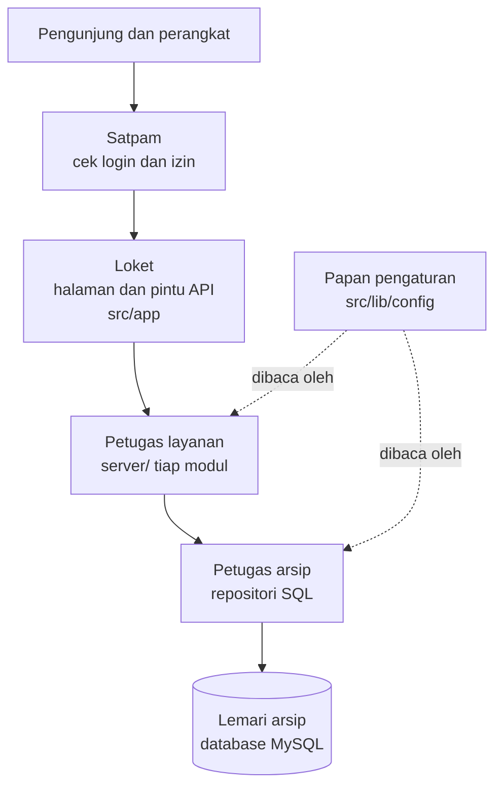
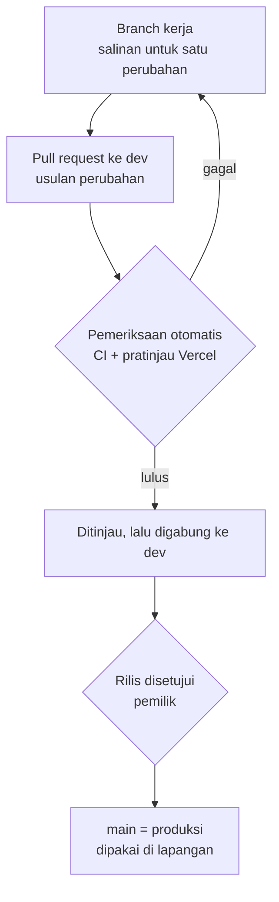

# Cara Kerja FTM dalam Bahasa Sehari-hari

Status: **terkini**, dicocokkan dengan kode pada 25 Oktober 2026.

Dokumen ini untuk pembaca yang tidak menulis kode: pengelola, peninjau, atau anggota
tim baru. Isinya menjelaskan apa yang dikerjakan FTM, bagian-bagiannya, dan pagar
pengaman yang menjaga kode tetap rapi. Rincian teknis ada di
[arsitektur](architecture.md) dan [catatan keputusan](decisions/README.md).

## FTM dalam satu paragraf

FTM (Fuel Tank Management) memantau isi tangki solar genset di lokasi STO. Sebuah
perangkat kecil di atas tangki mengukur jarak ke permukaan solar, lalu mengirim
angkanya lewat internet. FTM mengubah angka itu menjadi liter, persen isi, dan
perkiraan berapa jam lagi genset bisa menyala. Hasilnya tampil di dashboard bagi
petugas dan admin.

## Perjalanan satu angka, dari tangki sampai layar

1. **Mengukur.** Sensor ultrasonik mengukur jarak dari atas tangki ke permukaan solar.
   Makin jauh jaraknya, makin sedikit solarnya.
2. **Mengirim.** Perangkat mengirim jarak itu ke FTM, disertai kunci perangkat (seperti
   kata sandi khusus perangkat itu).
3. **Memeriksa.** FTM menolak kiriman yang kuncinya salah. Angka yang janggal, misalnya
   meloncat terlalu jauh, ditandai atau dirapikan.
4. **Menyimpan.** Database menyimpan dua hal: angka terbaru, dan ringkasan setiap
   5 menit (rata-rata, terendah, tertinggi) untuk grafik riwayat.
5. **Menghitung.** Dari ukuran tangki, FTM menghitung liter dan persen isi. Dari
   konsumsi genset (liter per jam), FTM menghitung perkiraan sisa jam menyala.
6. **Menampilkan.** Dashboard memuat ulang data secara berkala (bawaan: setiap 20
   detik) dan memberi warna status.

### Arti status di dashboard

| Yang dinilai       | Aturan                                                                                                                  |
| ------------------ | ----------------------------------------------------------------------------------------------------------------------- |
| Perangkat          | **Online** bila data terakhir datang dalam 2× jeda kirim; **terlambat** sampai 4× jeda; lebih lama dari itu **offline** |
| Isi tangki         | Di bawah 15% **kritis**, di bawah 30% **rendah**, di bawah 50% **perlu perhatian**, selebihnya **aman**                 |
| Sisa jam genset    | Di bawah 13 jam **kritis**, di bawah 16 jam **peringatan**, sampai 24 jam **terbatas**, lebih dari 24 jam **aman**      |
| Status keseluruhan | **Kritis** bila isi tangki atau sisa jam genset kritis, atau perangkat offline                                          |

## Bagian-bagian aplikasi, diibaratkan sebuah kantor

FTM adalah satu aplikasi web (dibuat dengan Next.js). Di dalamnya, pekerjaan dibagi
seperti kantor yang tertib: setiap bagian punya tugas sendiri dan hanya berurusan
dengan bagian yang memang ditentukan.

| Bagian kantor    | Di kode                                                     | Tugasnya                                                                              |
| ---------------- | ----------------------------------------------------------- | ------------------------------------------------------------------------------------- |
| Satpam           | `src/proxy.ts`, sesi, CSRF, OTP admin                       | Memastikan hanya orang yang sudah login (dan berperan sesuai) yang masuk              |
| Loket            | `src/app/` (halaman, API, aksi formulir)                    | Menerima permintaan dan menampilkan hasil; tidak boleh membuka lemari arsip sendiri   |
| Petugas layanan  | `src/features/<modul>/server/`                              | Menjalankan pekerjaan: menyetujui pengajuan, mengirim pesan bantuan, mereset data uji |
| Petugas arsip    | file `*-repository.ts`                                      | Satu-satunya yang menulis dan membaca database (perintah SQL)                         |
| Rumus            | file hitungan murni, misalnya `tank-volume.ts`, `status.ts` | Menghitung liter, persen, dan status; tidak menyentuh database, mudah dites           |
| Papan pengaturan | `src/lib/config/`                                           | Daftar semua pengaturan (alamat database, email, kunci) beserta penjelasannya         |

### Modul (divisi)

| Modul        | Mengurus                                                                         |
| ------------ | -------------------------------------------------------------------------------- |
| `monitoring` | Data tangki, perhitungan, dashboard, penerimaan data perangkat                   |
| `devices`    | Pengajuan perangkat baru, persetujuan, kunci perangkat, paket firmware, aktivasi |
| `auth`       | Akun, login, kode OTP admin, sesi, audit keamanan, Telegram                      |
| `helpdesk`   | Tombol bantuan di web dan penerusan pesan ke Telegram admin                      |

Rencana pemisahan berikutnya (perawatan data menjadi modul `admin`) dicatat di [ADR 0011](decisions/0011-struktur-modul-dan-aturan-lapisan.md).

### Contoh: perangkat baru dipasang

1. Petugas mengisi formulir pengajuan (nama STO, ukuran tangki, beban genset).
2. Admin meninjau, lalu menyetujui.
3. FTM membuat kode perangkat, kunci perangkat, dan paket firmware, lalu mengirim
   tautan unduh ke email petugas.
4. Petugas mengunduh paket dan memasangnya ke perangkat.
5. Kiriman pertama dari perangkat mengaktifkan perangkat itu di dashboard.

## Pagar pengaman yang bekerja otomatis

Aturan di atas tidak hanya ditulis, tetapi juga **dicek mesin** setiap kali kode
diubah. Kalau ada yang melanggar, perubahan ditolak sebelum sampai ke pengguna.

| Pagar                                    | Apa yang dicegah                                                           |
| ---------------------------------------- | -------------------------------------------------------------------------- |
| Aturan lapisan (ESLint)                  | Halaman atau API membuka database langsung tanpa lewat petugas layanan     |
| Penanda `server-only`                    | Kode database atau rahasia ikut terkirim ke browser pengunjung             |
| Aturan pengaturan (ESLint)               | Pengaturan dibaca sembarangan di luar papan pengaturan                     |
| Prettier                                 | Gaya penulisan kode yang tidak seragam                                     |
| TypeScript                               | Data yang salah bentuk, misalnya teks dikirim ke tempat yang meminta angka |
| Tes otomatis (229 unit, 16 dengan MySQL) | Rumus, kontrak perangkat, dan alur penting berubah tanpa disadari          |
| Audit dependensi                         | Pustaka dengan celah keamanan yang sudah diketahui                         |
| Format pesan commit                      | Riwayat perubahan yang sulit dibaca                                        |

## Dari perubahan kode sampai ke pengguna

- Setiap perubahan dikerjakan di branch sendiri, lalu diusulkan lewat pull request.
- `dev` adalah tempat mengumpulkan perubahan yang sudah lulus pemeriksaan.
- `main` adalah versi yang berjalan di produksi. Perubahan baru masuk ke `main` setelah
  pemilik menyetujui rilis.
- Setiap perubahan disertai bukti bahwa perilaku aplikasi tetap sama, kecuali memang
  disebutkan berbeda.

## Istilah

| Istilah             | Arti singkat                                                                                  |
| ------------------- | --------------------------------------------------------------------------------------------- |
| API / pintu API     | Alamat yang dipanggil program lain (misalnya perangkat) untuk mengirim atau meminta data      |
| Branch              | Salinan kode untuk mengerjakan satu perubahan tanpa mengganggu yang lain                      |
| CI                  | Pemeriksaan otomatis di GitHub setiap kali ada usulan perubahan                               |
| CSRF                | Pengaman agar aksi di FTM tidak bisa dipicu diam-diam dari situs lain                         |
| Database / MySQL    | Tempat menyimpan data secara permanen                                                         |
| Firmware            | Program yang berjalan di perangkat ESP8266                                                    |
| Modul               | Kelompok kode untuk satu urusan (monitoring, auth, helpdesk)                                  |
| OTP                 | Kode sekali pakai yang dikirim ke email admin saat login                                      |
| Pull request (PR)   | Usulan perubahan yang ditinjau dan dicek sebelum digabung                                     |
| Repositori          | Bagian kode yang berisi perintah ke database                                                  |
| Server / browser    | Server adalah komputer tempat FTM berjalan; browser adalah aplikasi web di perangkat pengguna |
| Variabel lingkungan | Pengaturan yang diisi di server (misalnya alamat database), bukan ditulis di kode             |
